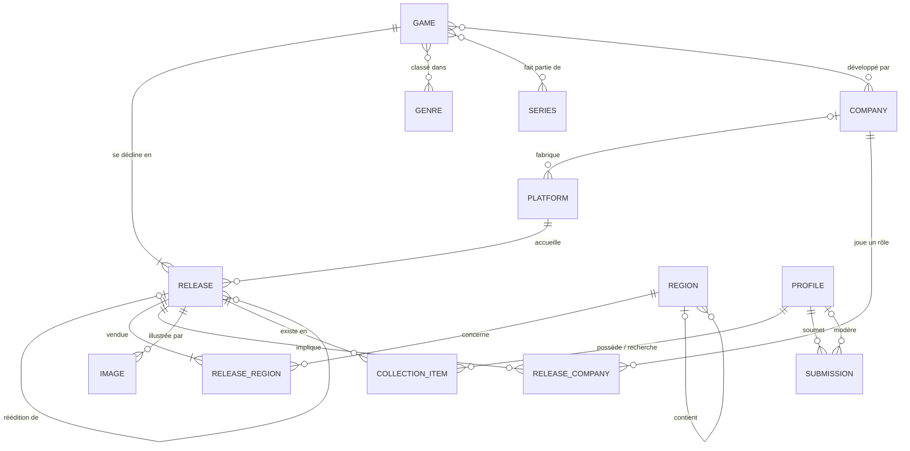

# Modèle de données

> **Projet :** Carte Mémoire (nom de travail), une base de données collaborative de jeux vidéo, en commençant par la PS1.
> **Étape 1** de la feuille de route · version 1 · **validée le 9 octobre 2026**
> Traduction SQL : [`supabase/migrations/`](../supabase/migrations/)

**Convention :** les noms techniques (tables, colonnes, valeurs) sont en anglais ; la documentation, les commentaires et les textes affichés sont en français.

---

## 1. Les trois niveaux à bien distinguer

Presque tout le modèle découle de cette séparation :

| Niveau | Table | Ce que c'est | Exemple |
|---|---|---|---|
| **Jeu** | `game` | L'œuvre, indépendante de la console | *Final Fantasy VII* |
| **Sortie** | `release` | Un produit précis mis en vente : une plateforme, une zone, une édition, un code produit | *Final Fantasy VII* sur PS1, version PAL française, `SCES-00868` |
| **Exemplaire** | `collection_item` | L'objet physique qu'un utilisateur possède (ou recherche) | « Ma boîte de FF7 PAL FR, complète, achetée 15 € » |

Ajouter une console (PS2, NES…) revient à ajouter **une ligne** dans `platform`, pas une nouvelle table.

---

## 2. Glossaire

| Français | Table | Français | Table |
|---|---|---|---|
| Société | `company` | Commercialisation (sortie × région) | `release_region` |
| Plateforme | `platform` | Participation (sortie × société) | `release_company` |
| Jeu | `game` | Image | `image` |
| Genre | `genre` | Profil | `profile` |
| Série | `series` | Exemplaire | `collection_item` |
| Région | `region` | Proposition | `submission` |
| Sortie | `release` | Liaisons jeu × genre / série / développeur | `game_genre`, `game_series`, `game_developer` |

---

## 3. Règles de gestion

### Catalogue

- **RG01** : Une plateforme a un nom, un nom court, une génération, un type (salon, portable, hybride), un type de support (CD-ROM, cartouche…) et une date de lancement. Elle est fabriquée par 0 ou 1 constructeur (une société). Un constructeur fabrique 0 à n plateformes.
- **RG02** : Chaque plateforme définit la liste de ses caractéristiques techniques propres (voir §6). Le formulaire d'ajout s'adapte à la plateforme choisie.
- **RG03** : Un jeu est une œuvre indépendante de la plateforme. Il a un titre de référence, un résumé et une date de première sortie (toutes plateformes et régions confondues : Tekken est sorti en 1994 en arcade, même si la version PS1 date de 1995). Cette date peut être connue sans savoir dans quelle région le jeu est sorti.
- **RG04** : Un jeu est développé par 0 à n sociétés (0 = pas encore renseigné). Une société développe 0 à n jeux.
- **RG05** : Un jeu est classé dans 0 à n genres. Un genre regroupe 0 à n jeux.
- **RG05bis** : Un genre appartient à 0 ou 1 **famille** (RPG, Course, Sport…), qui sert aux filtres et à la progression : « Tactical RPG » et « Action-RPG » comptent dans la famille RPG. Un genre sans famille est un **thème** (science-fiction, Noël, zombies…).
- **RG06** : Un jeu fait partie de 0 à n séries (*Crash Bandicoot*, *Final Fantasy*…). Une série regroupe 0 à n jeux.
- **RG07** : Un jeu a au moins une sortie (1 à n). Une sortie concerne exactement un jeu.
- **RG08** : Une sortie concerne exactement une plateforme. Une plateforme a 0 à n sorties.
- **RG09** : Une sortie est un **produit distinct**. Toute différence de zone, de pays/langue, de code produit ou d'édition donne une sortie différente. Par exemple, FF7 PAL existe en versions française, allemande et anglaise avec des codes différents, soit 3 sorties.
- **RG09bis** : Une **réédition** (Platinum, Greatest Hits, The Best…) est une sortie à part entière, reliée à la sortie d'origine. Une sortie a 0 ou 1 sortie d'origine ; une sortie d'origine a 0 à n rééditions. Une réédition concerne forcément le même jeu que l'original.
- **RG10** : Une sortie a un titre local (*Biohazard* au Japon = *Resident Evil* ailleurs), un code produit, un code-barres, un format (physique, dématérialisé), une zone (NTSC-J, NTSC-U, PAL, sans zone), un type et un nom d'édition, un nombre de supports (disques ou cartouches), un nombre de joueurs maximum, une classification d'âge, des langues, et les caractéristiques propres à sa plateforme.
- **RG11** : Une sortie est commercialisée dans 1 à n régions, avec une date de sortie par région. Une région voit 0 à n sorties.
- **RG12** : Une date de sortie peut n'être connue qu'au mois ou à l'année. On enregistre donc sa **précision** (jour, mois, année).
- **RG13** : Les régions sont hiérarchisées : un pays appartient à une zone (France ⊂ Europe), une zone au Monde. On peut ainsi enregistrer une sortie « en Europe » sans connaître le détail par pays.
- **RG14** : Une sortie est liée à 0 à n sociétés, chacune avec un **rôle** (éditeur, distributeur, développeur du portage). L'éditeur peut changer selon la région : FF7 a été édité par Square au Japon et par Sony en Amérique du Nord et en Europe.
- **RG15** : Une sortie a 0 à n images (jaquette recto, verso, tranche, disque, notice, capture d'écran). Une image illustre exactement une sortie. Les images sont rattachées à la **sortie** et non au jeu : la jaquette japonaise, l'américaine, la française et la Platinum sont donc toutes distinctes. Plusieurs images du même type sont possibles pour une même sortie (variantes de jaquette d'un même produit).
- **RG15bis** : Sur PS1 et PS2, une sortie d'édition standard est ce que les collectionneurs appellent la version **Black Label**. Ce n'est pas une donnée à saisir : le site l'affiche à partir de la plateforme et du type d'édition.

### Communauté

- **RG16** : Tout le monde, même sans compte, peut consulter le catalogue.
- **RG17** : Un utilisateur a un pseudo unique et un rôle : membre, modérateur ou admin.
- **RG18** : Un membre ne modifie jamais le catalogue directement. Il soumet une **proposition** (création, modification ou suppression), en indiquant ses sources. Une proposition peut contenir un ensemble complet : un jeu, ses sorties, une société qui n'existait pas encore…
- **RG19** : Une proposition est en attente, acceptée ou refusée. Elle est traitée par 0 ou 1 modérateur, avec un commentaire en cas de refus. Une fois acceptée, son contenu est appliqué au catalogue.
- **RG20** : Les modérateurs et les admins peuvent modifier le catalogue directement.
- **RG21** : Un utilisateur a 0 à n exemplaires. Un exemplaire appartient à exactement un utilisateur et correspond à exactement une sortie. Un utilisateur peut avoir **plusieurs exemplaires de la même sortie** (doubles). C'est pour ça que `collection_item` est une entité et non une simple association « possède ».
- **RG22** : Un exemplaire est soit **possédé**, soit **recherché** (liste de souhaits). Pour un exemplaire possédé, on note la présence de la boîte, de la notice et du support (et de la spine card au Japon), l'état (du « neuf sous blister » au « mauvais état », en distinguant un blister refait), s'il a été acheté neuf ou d'occasion, où, à quel prix et quand, s'il est proposé à l'échange ou à la vente, et des notes. Ces détails n'existent pas pour un exemplaire recherché.
- **RG23** : Une collection est privée par défaut. L'utilisateur peut la rendre publique.
- **RG24** : Progression : un jeu est **possédé dans une zone** dès qu'au moins une de ses sorties de cette zone est possédée (Black Label ou Platinum, peu importe ; trois exemplaires comptent pour un jeu). On compte des **jeux**, pas des exemplaires : « 312 jeux PAL sur 1 286 ». Le catalogue et la progression ne regardent que la collection de la personne connectée.
- **RG25** : Une collection s'exporte en CSV (toutes les colonnes, identifiant de version compris) et s'importe depuis un CSV. À l'import, chaque ligne est rattachée à une sortie par son identifiant, sinon son code produit, sinon son titre exact ; la zone et l'édition départagent. Les lignes douteuses (Black Label ou Platinum avec le même code…) sont à vérifier par la personne avant l'ajout, et les sorties déjà possédées sont ignorées par défaut pour ne pas créer de doubles.
- **RG26** : Un modérateur peut supprimer un jeu ou une version, sauf si un membre l'a dans sa collection (possédé ou recherché) : pour un doublon, on fusionne. Une version unique ne se supprime pas seule. Chaque suppression est notée dans un journal (`catalog_deletion`).
- **RG27** : Les caractéristiques d'une version (blocs de carte mémoire, manette analogique, vibrations…) sont celles prévues par sa console (`platform.spec_fields`) ; la base refuse toute autre clé ou valeur. « Non précisé » (absent) n'est pas « Non ».
- **RG28** : Un membre peut signaler une erreur sur un jeu ou une version (20 signalements par jour au plus). Un modérateur la classe « corrigée » ou « rejetée », avec un mot visible par l'auteur.
- **RG29** : Toute modification du catalogue faite par une personne connectée (jeu, version, genre d'un jeu, image) est notée dans l'historique (`catalog_change`) avec son auteur et les valeurs avant et après. Un modérateur peut annuler une modification simple si rien n'a changé depuis ; l'annulation est notée à son tour.
- **RG30** : L'origine d'un jeu est le pays de son studio de développement : celle choisie par un modérateur (ou importée de Wikidata), sinon celle de ses studios s'ils sont tous connus et du même pays, sinon inconnue. Un JRPG est un jeu de la famille RPG d'origine japonaise ; un RPG occidental, d'une autre origine connue.

---

## 4. MCD



Pour lire les symboles : `||` = exactement 1, `|o` = 0 ou 1, `|{` = 1 ou plusieurs, `o{` = 0 ou plusieurs.

- Les associations n,n simples (genres, séries, développeurs) deviennent des **tables de liaison** : `game_genre`, `game_series`, `game_developer`.
- `release_region` (avec la date) et `release_company` (avec le rôle) sont des **associations porteuses de données**. Elles sont dessinées comme des entités parce qu'elles portent des attributs.

---

## 5. Dictionnaire de données

Toutes les tables principales ont aussi `created_at` et, si elles sont modifiables, `updated_at` (mis à jour automatiquement).

### `platform`

| Colonne | Type | Oblig. | Exemple | Remarque |
|---|---|:-:|---|---|
| id | identifiant | ✔ | | |
| name | texte | ✔ | PlayStation | |
| short_name | texte | ✔ | PS1 | unique |
| generation | entier | | 5 | |
| type | liste | ✔ | home | home (salon), handheld (portable), hybrid |
| media | texte | | CD-ROM | type de support |
| launch_date | date | | 1994-12-03 | première sortie mondiale |
| spec_fields | JSON | ✔ | voir §6 | décrit les champs propres à la console |
| manufacturer_id | → company | | Sony | constructeur |
| wikidata_id | texte | | Q10677 | sert à l'import, unique |

### `game`

| Colonne | Type | Oblig. | Exemple | Remarque |
|---|---|:-:|---|---|
| id | identifiant | ✔ | | |
| title | texte | ✔ | Final Fantasy VII | titre de référence (international) |
| summary | texte long | | | résumé |
| first_release_date | date | | 1997-01-31 | première sortie de l'œuvre, toutes plateformes confondues |
| first_release_precision | liste | | day | day, month, year ; obligatoire si une date est saisie |
| wikidata_id | texte | | | sert à l'import, unique |
| title_key | texte (calculé) | | finalfantasyvii | clé de comparaison anti-doublons, calculée automatiquement (§8) |

### `release`

| Colonne | Type | Oblig. | Exemple | Remarque |
|---|---|:-:|---|---|
| id | identifiant | ✔ | | |
| game_id | → game | ✔ | | |
| platform_id | → platform | ✔ | PS1 | |
| reissue_of | → release | | | sortie d'origine pour une réédition (Platinum…) ; même jeu obligatoire |
| local_title | texte | ✔ | Final Fantasy VII | tel qu'imprimé sur la boîte |
| product_code | texte | | SCES-00868 | code du disque 1 pour les jeux à plusieurs disques ; **pas unique** (une réédition peut garder le code de l'original) |
| barcode | texte | | | EAN ou UPC (8 à 14 chiffres), permettra un scan au téléphone plus tard |
| format | liste | ✔ | physical | physical, digital |
| zone | liste | | PAL | NTSC-J, NTSC-U, PAL, region_free |
| edition_type | liste | ✔ | standard | standard, reissue, collector, demo, promo, bundle |
| edition_name | texte | | Platinum | précision libre : Platinum, Greatest Hits, The Best… |
| media_count | entier | | 3 | nombre de disques ou cartouches (FF7 = 3 CD) |
| max_players | entier | | 1 | |
| age_rating | texte | | PEGI 16 | PEGI, ESRB, CERO, USK… |
| languages | liste de codes | ✔ | {fr} | codes ISO 639-1 en minuscules, plusieurs pour les versions multilingues |
| specs | JSON | ✔ | voir §6 | valeurs des champs propres à la plateforme |

### `release_region` (sortie × région)

| Colonne | Type | Oblig. | Exemple | Remarque |
|---|---|:-:|---|---|
| release_id | → release | ✔ | | clé avec `region_id` |
| region_id | → region | ✔ | FR | |
| release_date | date | | 1997-11-01 | « novembre 1997 » est stocké au 1er du mois, « 1997 » au 1er janvier |
| date_precision | liste | | month | day, month, year ; obligatoire si une date est saisie |

### `region`

| Colonne | Type | Oblig. | Exemple | Remarque |
|---|---|:-:|---|---|
| id | identifiant | ✔ | | |
| code | texte | ✔ | FR | unique ; code ISO en majuscules pour les pays, minuscules pour les zones (`europe`, `asia`…) |
| name | texte | ✔ | France | nom affiché |
| type | liste | ✔ | country | world, zone, country |
| parent_id | → region | | europe | seul « Monde » n'a pas de parent |

### `company`

| Colonne | Type | Oblig. | Exemple | Remarque |
|---|---|:-:|---|---|
| id | identifiant | ✔ | | |
| name | texte | ✔ | Square | studios, éditeurs et constructeurs dans une seule table |
| country | texte | | JP | code ISO |
| wikidata_id | texte | | | unique |
| name_key | texte (calculé) | | square | clé de comparaison anti-doublons (§8) |

### `release_company` (sortie × société)

| Colonne | Type | Oblig. | Exemple | Remarque |
|---|---|:-:|---|---|
| release_id | → release | ✔ | | clé avec `company_id` et `role` |
| company_id | → company | ✔ | Sony Interactive Entertainment | |
| role | liste | ✔ | publisher | publisher (éditeur), distributor, porting (développeur du portage) |

### `genre` et `series`

| Colonne | Type | Oblig. | Exemple | Remarque |
|---|---|:-:|---|---|
| id | identifiant | ✔ | | |
| name | texte | ✔ | Jeu de rôle / Final Fantasy | unique pour les genres, pas pour les séries |
| wikidata_id | texte | | | unique |
| family | liste | | rpg | genres seulement : grande famille (action, adventure, rpg, platform, fighting, shooter, racing, sports, puzzle, strategy, simulation, music, horror, visual_novel, party). Vide pour un thème (science-fiction, Noël…) |

### `image`

| Colonne | Type | Oblig. | Exemple | Remarque |
|---|---|:-:|---|---|
| id | identifiant | ✔ | | |
| release_id | → release | ✔ | | |
| type | liste | ✔ | front | front (recto), back, spine (tranche), disc, manual, screenshot |
| path | texte | ✔ | | emplacement du fichier dans le stockage Supabase, unique |
| uploaded_by | → profile | | | |

### `profile`

| Colonne | Type | Oblig. | Exemple | Remarque |
|---|---|:-:|---|---|
| id | identifiant | ✔ | | le même que le compte Supabase |
| username | texte | ✔ | Alexis | unique sans tenir compte des majuscules ; 3 à 30 caractères (lettres, chiffres, `_`, `-`) |
| avatar | texte | | | chemin d'image |
| role | liste | ✔ | member | member, moderator, admin |
| public_collection | booléen | ✔ | false | |

L'e-mail et le mot de passe sont gérés par Supabase Auth et ne sont pas stockés dans nos tables. On garde le minimum de données personnelles (RGPD). Le profil est créé automatiquement à l'inscription.

### `collection_item`

| Colonne | Type | Oblig. | Exemple | Remarque |
|---|---|:-:|---|---|
| id | identifiant | ✔ | | permet les doubles |
| profile_id | → profile | ✔ | | rempli automatiquement avec l'utilisateur connecté |
| release_id | → release | ✔ | | une sortie possédée par quelqu'un ne peut pas être supprimée |
| status | liste | ✔ | owned | owned (possédé), wanted (recherché) |
| condition | liste | | good | sealed (neuf sous blister d'origine), resealed (reblisté), like_new (comme neuf), very_good, good, fair, poor |
| has_box / has_manual / has_media | booléens | | true / true / true | « complet » = les trois |
| purchase_price | décimal | | 15.00 | |
| purchase_date | date | | | |
| acquisition | liste | | used | new (acheté neuf), used (d'occasion), gift (cadeau), trade (échange) |
| purchase_place | texte | | Brocante de Lyon | 80 caractères au plus |
| has_spine_card | booléen | | true | bande cartonnée sur la tranche (boîtes japonaises) |
| trade_status | liste | | for_trade | for_trade (à échanger), for_sale (à vendre) ; vide = gardé |
| notes | texte | | | |

### `submission`

| Colonne | Type | Oblig. | Exemple | Remarque |
|---|---|:-:|---|---|
| id | identifiant | ✔ | | |
| author_id | → profile | | | rempli automatiquement avec l'utilisateur connecté |
| action | liste | ✔ | create | create, update, delete |
| target | liste | ✔ | game | game, release, company, series, genre, image |
| target_id | identifiant | | | vide pour une création, obligatoire sinon |
| data | JSON | ✔ | | le contenu proposé (peut contenir un jeu complet avec ses sorties) |
| sources | texte | | « photo de ma boîte » | d'où vient l'information |
| status | liste | ✔ | pending | pending, approved, rejected ; jamais choisi par le membre |
| moderator_id | → profile | | | |
| review_note | texte | | | explication du modérateur (en cas de refus) |
| reviewed_at | date et heure | | | rempli dès que la proposition est traitée |

---

## 6. Caractéristiques propres à chaque plateforme

Chaque console a ses particularités. Plutôt que de créer une table par console, on décrit ces champs **une fois** dans `platform.spec_fields`. Le formulaire lit cette description pour savoir quoi afficher, et les valeurs sont rangées dans `release.specs`.

Définition pour la PS1 (`key` et `value` en anglais, `label` en français car affiché) :

```json
[
  { "key": "memory_card_blocks", "label": "Blocs de carte mémoire", "type": "integer", "min": 1, "max": 15 },
  { "key": "analog", "label": "Manette analogique", "type": "choice",
    "options": [
      { "value": "no", "label": "Non" },
      { "value": "compatible", "label": "Compatible" },
      { "value": "required", "label": "Requise" }
    ] },
  { "key": "vibration", "label": "Vibrations", "type": "boolean" },
  { "key": "multitap", "label": "Compatible Multitap", "type": "boolean" },
  { "key": "link_cable", "label": "Câble Link", "type": "boolean" },
  { "key": "peripherals", "label": "Périphériques", "type": "multi_choice",
    "options": [
      { "value": "mouse", "label": "Souris" },
      { "value": "guncon", "label": "GunCon" },
      { "value": "negcon", "label": "neGcon" },
      { "value": "wheel", "label": "Volant" },
      { "value": "pocketstation", "label": "PocketStation" }
    ] }
]
```

Valeurs pour la sortie PAL FR de FF7 :

```json
{ "memory_card_blocks": 1, "analog": "no", "vibration": false, "multitap": false, "link_cable": false, "peripherals": [] }
```

Pour la NES, la définition contiendrait d'autres champs (sauvegarde par pile, puce spéciale…) sans toucher à la structure de la base.

---

## 7. Imports : Wikidata et Wikipédia

Mesuré le 9 octobre 2026 sur les jeux liés à la PlayStation (`Q10677`) :

| Information | Jeux concernés |
|---|---|
| Jeux PS1 recensés | **2 209** |
| Avec une date de sortie | 1 872 (85 %) |
| Avec au moins un genre | 1 659 (75 %) |
| Avec au moins un éditeur | 1 355 (61 %) |
| Avec au moins un développeur | 1 299 (59 %) |
| Avec un titre en français | 1 271 (58 %) |
| Avec une série | 798 (36 %) |
| Avec des dates **par région** | 358 (16 %) |

**Conclusion :** Wikidata fournit le squelette (jeux, développeurs, genres, séries, première date). Le détail des sorties régionales (codes produits, éditions, langues, jaquettes) viendra surtout des contributions. Les sorties sans code produit seront affichées comme « à compléter » pour inviter les visiteurs à contribuer.

### Comment l'import fonctionne

Le script [`scripts/import-wikidata.mjs`](../scripts/import-wikidata.mjs) interroge Wikidata et **écrit une migration SQL** (`supabase/migrations/…_import_wikidata_ps1.sql`), envoyée ensuite avec `npx supabase db push`. Aucune clé secrète n'est nécessaire, et la migration peut être testée en local avant l'envoi.

Règles appliquées :

- **Date de première sortie** du jeu : la plus ancienne date connue, toutes plateformes confondues.
- **Dates PS1 par région** : seulement si la date concerne explicitement la PS1, ou si le jeu n'existe que sur PS1. Beaucoup de dates Wikidata concernent une autre console (SNES, 3DO, PC…) et sont écartées.
- **Sorties** : une par zone vidéo connue (NTSC-J, NTSC-U, PAL), avec le titre japonais pour la sortie NTSC-J. Sans information régionale, une seule sortie « à compléter » est créée.
- **Éditeurs** : rattachés à une sortie seulement si c'est sûr (région précisée, ou un seul éditeur connu pour le jeu). Sinon, ils sont laissés aux contributeurs.
- **Développeurs** : ceux d'une autre version (arcade, PC…) sont écartés.
- **Genres** : libellé français, avec quelques renommages (« Jeu vidéo de rôle » → « RPG »).
- **Ré-exécutable** : rien n'est dupliqué, et les sorties ne sont créées que pour les jeux qui n'en ont aucune.

Résultat du 9 octobre 2026 : **2 208 jeux**, **2 291 sorties PS1** (179 NTSC-J, 70 NTSC-U, 49 PAL, 1 993 « à compléter »), 535 sociétés, 202 genres, 381 séries.

### Deuxième source : les listes de Wikipédia

Wikidata ne connaît qu'environ la moitié des jeux PS1. Les listes « List of PlayStation (console) games » (A–L et M–Z) de Wikipédia en anglais en recensent **4 075**, avec pour chacun les dates Japon / Europe / Amérique du Nord, les titres régionaux, les éditeurs par région et un repère pour les versions Platinum.

Le script [`scripts/import-wikipedia.mjs`](../scripts/import-wikipedia.mjs) lit ces listes et écrit une migration qui **fusionne** avec l'existant :

- **Même jeu** : même identifiant Wikidata (via le lien de l'article), sinon même titre normalisé (§8). Le jeu existant est complété, jamais dupliqué. Un lien vers un article qui n'est pas un jeu (une série, une page partagée par plusieurs lignes) est ignoré.
- **Sorties** : une par zone où le jeu est sorti. Une sortie « à compléter » existante reçoit sa zone au lieu d'être doublée.
- **Titres régionaux** : le titre japonais ou PAL va sur la sortie de la zone. Un titre propre à un pays (*Dream Story* pour *40 Winks* en France) crée une **version nationale**, comme prévu par RG09.
- **Platinum** : une réédition reliée à la sortie PAL d'origine.
- **Éditeurs** : selon la région indiquée dans la liste (FF7 : Square au Japon, Sony ailleurs) ; sans indication, seulement s'il n'y en a qu'un.
- **Ré-exécutable** : les deux imports peuvent être relancés dans n'importe quel ordre sans créer une seule ligne en double (vérifié).

Résultat après fusion des deux sources : **4 508 jeux**, **6 275 sorties** (dont 148 Platinum, 31 versions nationales, 387 encore « à compléter »), 5 764 dates par région, 1 348 sociétés.

Les jeux en plus des 4 075 de la liste viennent de Wikidata : homebrew, Net Yaroze, jeux non licenciés… et quelques doublons que seul un humain peut trancher (voir §8).

---

## 8. Doublons

On ne peut pas interdire deux jeux du même nom : « Doom » (1993) et « Doom » (2016) sont deux jeux différents. La protection se fait donc en plusieurs couches :

| Couche | Rôle |
|---|---|
| `wikidata_id` unique | Un même identifiant Wikidata ne peut pas exister deux fois |
| `title_key` / `name_key` | Clé calculée automatiquement : titre sans majuscules, accents, espaces ni ponctuation (`Pokémon: Snap` → `pokemonsnap`) |
| Imports | Rapprochement par identifiant Wikidata, puis par clé de titre |
| Vue `possible_duplicate_game` (et `possible_duplicate_company`) | Liste pour les modérateurs des fiches qui partagent la même clé |
| Formulaire de contribution (étape 5) | Avant de créer un jeu, propose ceux qui existent déjà avec un titre proche |
| Fonction `merge_games(garde, doublon)` | Fusionne deux fiches : sorties, développeurs, genres, séries et infos manquantes passent sur la fiche gardée. Réservée aux modérateurs, refusée si les deux fiches ont des identifiants Wikidata différents. L'interface viendra à l'étape 5 |

> **Leçon retenue :** la normalisation n'utilise que des listes de caractères explicites. Une première version reposait sur la classe `[[:punct:]]` de PostgreSQL, dont le contenu varie selon le serveur. Sur Supabase, `~` et `+` n'en faisaient pas partie, ce qui a laissé passer 5 doublons (*Xevious 3D/G* et *Xevious 3D/G+*…). Ils ont été corrigés par la migration `normalize_name_fix`.

Après les deux imports, il reste **29 doublons possibles** à vérifier. Ce sont surtout des doublons dans Wikidata lui-même (deux fiches pour *Tales of Phantasia*, *Mad Stalker*…), ou un original d'arcade à côté de son remake PS1 (*Frogger* 1981 et 1997, *Space Invaders*…).

---

## 9. Licence des données

| Source | Licence | Obligation |
|---|---|---|
| Wikidata | CC0 | Aucune (citation appréciée) |
| Wikipédia | CC BY-SA 4.0 | **Citer la source** sur le site, et diffuser les données qui en sont issues sous la même licence |

Le catalogue de Carte Mémoire est donc publié sous **CC BY-SA 4.0**, avec une mention en pied de page : « Données du catalogue issues en partie de Wikipédia (CC BY-SA 4.0) et de Wikidata (CC0) ». C'est cohérent avec un projet communautaire : les contributions restent librement réutilisables.

---

## 10. Hors périmètre de la v1 (prévu pour plus tard)

- Notes et avis des utilisateurs
- Personnes et crédits (compositeurs, directeurs…)
- Liens entre jeux : suite, remake, portage, spin-off
- Compilations et disques de démo contenant plusieurs jeux
- Détail par disque (code de chaque CD, empreintes Redump pour vérifier les copies)
- Consoles et accessoires dans la collection
- Cote / prix du marché
- Masquer les prix d'achat dans une collection publique
- Historique détaillé champ par champ (les propositions acceptées servent d'historique pour l'instant)
- Interface et contenu en plusieurs langues
- Recherche tolérante aux fautes et aux accents (à l'étape 4)
- **Tri des genres** : Wikidata mélange genres (course, combat), thèmes (cyberpunk, western) et quelques erreurs. À terme : une liste courte de genres, et les thèmes à part
- Légende sur les images (« première impression », « couverture alternative »…), à l'étape 5
- **Résumés des jeux** (`game.summary`, vide pour l'instant) : aucune des deux sources n'en fournit. À décider : intro de Wikipédia en français (avec lien vers l'article) ou rédaction par les contributeurs
- Outil de fusion de deux fiches pour les modérateurs, à l'étape 5

---

## 11. Décisions

- [x] Nom du projet : « carte-memoire » en attendant mieux
- [x] Une sortie par version nationale PAL (FR, DE, UK séparées), **et une sortie par réédition** (Platinum…), reliée à l'originale
- [x] Collections privées par défaut (RG23)
- [x] Modérateurs et admins autorisés à modifier le catalogue sans passer par une proposition (RG20)
- [x] Noms techniques en anglais
